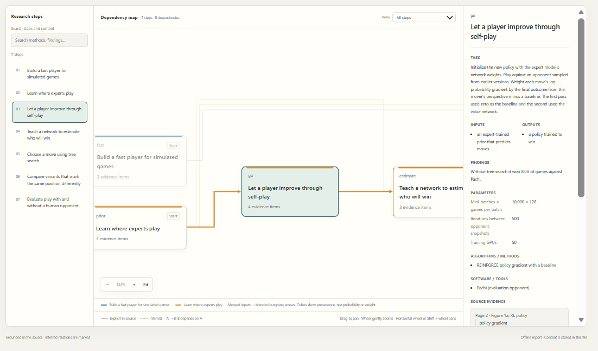
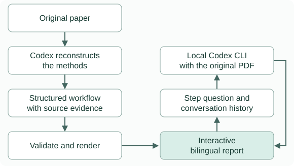

# paper2flow

[English](README.md) · [简体中文](README.zh-CN.md)

A research workflow skill for Codex: turn a paper into an interactive, evidence-linked explanation.

**paper2flow** is a Codex skill that creates an interactive, evidence-linked methods report. Explore parallel branches and merged inputs, inspect the original passages behind a dependency, and ask follow-up questions grounded in the original PDF.



Download the HTML report and open it in a browser: [AlphaGo](examples/alphago/index.html) · [EHT imaging of M87](examples/eht/index.html).

**License:** [MIT](LICENSE) — free to use, modify, redistribute, and integrate into commercial projects.

## What you get

- **A methods dependency map:** each node explains its task, inputs, outputs, parameters, findings, and evidence. Arrows distinguish explicit dependencies from analyst inferences.
- **English-first bilingual reports:** write the English account directly from the original paper, then translate it into Chinese. Switching languages updates the entire report, including details, print content, exports, and question context.
- **Original-PDF questions:** the optional local bridge reuses your installed Codex CLI and its existing authentication. It binds the original PDF automatically.
- **Per-node follow-ups:** start a new topic or continue with the node's completed question/answer history. Conversations stay separate across nodes.
- **A usable canvas:** gentle pointer-centered zoom, horizontal-wheel and Shift-wheel pan, drag without text selection, keyboard controls, search, focus filters, and light/dark themes.
- **Input provenance colors:** source colors stay stable when selecting nodes or changing themes. Merged branches propagate all source colors as gradients, including workflows with 100 distinct origins.

Use it to understand a paper, inspect its evidence, and plan your next research step.

## Workflow design



The project combines four pieces of research-agent engineering:

- **Evidence-grounded workflow design:** represent methods, parameters, inputs, outputs, and dependencies in a structured contract linked to the original paper.
- **Agent and tool integration:** connect a guided Codex analysis workflow to PDF extraction, data validation, report rendering, and a local question bridge.
- **Context management:** assemble the selected node, its dependencies, the original PDF, and that node's completed conversation for each follow-up.
- **Product engineering:** deliver complete English/Chinese reports, a navigable dependency canvas, stable provenance colors, and deterministic interaction checks.

## Build with an Agent

Open this repository folder in Codex and send the prompt below. Attach your paper if you want Codex to create your first report in the same session.

```text
Install and deploy paper2flow from the current repository on my computer.

Read SKILL.md and its relevant references. Detect my operating system and
available Python environment, install the skill in the appropriate Codex
skills directory, and install the dependencies it needs. Check that the skill
files and helper commands are ready, and use my existing Codex CLI login
and configuration for node questions.

If I have attached a paper or provided its path, use the installed skill to
explain that paper's methods. Write the English account directly from the
original paper and translate the complete account into Chinese. Validate
the workflow, render the interactive report, bind the original PDF,
configure local node questions and follow-up context automatically, start
the local report service, and open the working report in my browser.
Create a reusable launch entry so I can reopen it later.

Complete the available setup and give me the installed skill location,
how to invoke it, and the report's launch entry when a report was created.
```

## If you really want to build it manually

### Requirements

| Component | Needed for |
| --- | --- |
| Codex with skill support | Reading the paper and writing its evidence-linked account |
| Python 3.10+ | Local extraction, validation, rendering, and report server |
| `pypdf` | PDF extraction and PDF-backed questions |
| An installed, signed-in Codex CLI | Optional live node questions |
| Node.js | Optional JavaScript regression checks |

The interface is self-contained HTML, CSS, and JavaScript. There is no frontend build step, remote script dependency, or model SDK in this repository.

### Install as a Codex skill

Download or clone this repository and place its contents in a folder named `paper2flow`:

- macOS/Linux: `~/.agents/skills/paper2flow/`
- Windows: `%USERPROFILE%\.agents\skills\paper2flow\`

`SKILL.md` should sit directly inside that folder. Alternatively, use a project-scoped `.agents/skills/paper2flow/` directory. See the [official skill documentation](https://developers.openai.com/codex/skills/) for discovery and invocation details.

From the skill/repository folder, install the PDF dependency using your Python interpreter:

```bash
python -m pip install -r requirements.txt
```

Use `python3` instead of `python` if that is your interpreter command. No OpenAI API key is required by the skill itself. Live questions use the Codex CLI's existing authentication and configuration.

Then ask Codex:

```text
Use $paper2flow to explain the methods of this paper.
Focus on how its inputs, processing steps, and validation depend on each other.
Write the English account from the original paper and provide a Chinese translation.
Create the interactive report and configure its local node questions.
Explain the paper; do not implement its model.
```

### Use your own paper

#### 1. Extract the original

```bash
python scripts/paper2flow.py extract paper.pdf --out out/paper.txt
```

This also writes `out/paper.txt.source.json` with source metadata and the original PDF binding. Scanned or unextractable pages need OCR or visual inspection; the extractor does not invent missing content.

#### 2. Have Codex reconstruct the methods

Ask Codex to read the original source and produce:

- `out/workflow.json`: the English primary account, schema version `1.0`.
- `out/workflow.zh.json`: a full Chinese translation of that account.

The deterministic helper scripts validate and render these files; they do not independently understand the paper. Follow [SKILL.md](SKILL.md), the [analysis guide](references/analysis-guide.md), and the [data contract](references/data-contract.md).

Translations preserve source identity, node IDs, dependencies, explicit/inferred labels, and exact original-language evidence. Parameters and scientific meanings must remain equivalent. The renderer rejects structural/evidence changes; checking the scientific meaning remains the author's responsibility.

#### 3. Render and launch

```bash
python scripts/paper2flow.py render out/workflow.json --translation zh=out/workflow.zh.json --out out/report.html
python scripts/report_server.py out --launch --open
```

The renderer also creates `OPEN_REPORT.cmd` and `OPEN_REPORT.sh` next to the report. On Windows, double-click the `.cmd` file. On macOS/Linux, run `sh out/OPEN_REPORT.sh`. Launchers are generated for the current installation; regenerate them if you move the skill, report, or Python interpreter.

The server starts or reuses the report's own local service, checks readiness, and opens the actual URL. It chooses an available port and does not stop other services. A localhost URL works only while its service is running; use the launch entry again when needed.

English is the default. To start in Chinese, supply the complete translation and add `--language zh`. If no Chinese translation is supplied, the interface clearly marks it unavailable rather than changing labels alone.

## Asking and following up

1. Select a node and open **Ask Codex**.
2. Enter a question. **Ask Codex** starts a new topic for that node.
3. Enter a later question and choose **Follow up** to include that node's completed exchanges.

Each request includes the original PDF, the selected node, relevant dependencies, and the active-language report context. The bridge checks the original fingerprint and uses a read-only Codex CLI run. A previous answer is conversation context, not paper evidence.

History stays in page memory across node and language changes. Refreshing or closing the page clears it. Failed requests preserve earlier successful exchanges. Oversized histories are rejected explicitly rather than silently shortened. A live question uses the account/model configuration of your local Codex CLI and may incur usage charges.

If the original PDF moves, update its verified path in both language workflows, rerender, and restart the report service. There is no need to enter a new API key or manually reconnect a bridge token.

## Privacy and bridge boundaries

- **No credentials are bundled.** Every user runs their own Codex CLI with their own login. Installing this repository does not transfer anyone else's account access.
- **Saved reports and live pages differ.** The server generates a bridge bearer token in memory and injects it into the live local response. The saved HTML and workflow JSON do not contain that runtime token. The legacy diagnostic `agent_bridge.py` command prints its bridge token to its terminal; keep that output private.
- **Trusted local use only.** The server listens on `127.0.0.1`. Its served page intentionally contains the bridge token, so another local program able to fetch that page can obtain it. Loopback and browser origin checks are not isolation from untrusted local users or processes. Do not expose, proxy, or tunnel the service publicly.
- **Read-only is not credential isolation.** The bridge inherits the local CLI environment/configuration. It does not provide a separate credential sandbox or guarantee that malicious source content cannot influence the agent.
- **Live questions use your configured model provider.** Full extracted PDF text, question context, and any follow-up history are sent through Codex. Use appropriate settings for sensitive or restricted material. Offline report browsing does not call a model.
- **Generated artifacts can be private.** Reports and launchers may contain local paths or research content. Do not commit them or save a live page containing a runtime token for distribution.

The included `.gitignore` excludes common generated files, papers, launchers, caches, credentials, and runtime state. It does not remove files already tracked by Git. Review what you commit.

## Verify changes

```bash
python scripts/check_report_defaults.py
```

If Node.js is not on `PATH`, pass `--node` with its executable path. If Node is unavailable, the runner explicitly reports the skipped JavaScript checks.

The tests create a temporary synthetic PDF and local HTTP service, use a fake answer executor, and clean up afterward. They check complete language switching, exports, follow-up isolation, canvas interactions, 1–100 source colors, request guards, launch reuse, and port fallback. They do not call Codex or a model, prove scientific validity, or replace visual browser review.

## Repository layout

```text
SKILL.md                  Skill entry point
agents/openai.yaml        Codex skill metadata
assets/                   HTML report template
references/               Analysis, data, interaction, and node-question guidance
scripts/                  Extraction, rendering, local bridge, and regression checks
requirements.txt          PDF dependency
LICENSE                   MIT License
NOTICE                    Copyright and attribution notices
LICENSE.zh-CN.md           Chinese license explanation
```

## Credit and research use

Keep the applicable copyright and attribution notices when redistributing the project. [NOTICE](NOTICE) records the project attribution.

If paper2flow helps your research, please acknowledge the project and link to the repository. Citations and links help other researchers discover the workflow.

Contributions are welcome: bring a clear use case, an example, and a way to check the resulting behavior. See **Verify changes** for the existing checks.

## License

[MIT License](LICENSE). You may use, modify, redistribute, and build commercial products with this project under its terms. Include the copyright notice and permission notice in all copies or substantial portions of the software.

Original project code, skill instructions, documentation, templates, and examples are covered by this license unless a file says otherwise. Independent dependencies retain their own licenses. Your research content keeps its own rights.

Contributions are submitted under MIT unless explicitly stated otherwise. This is an independent community project.
