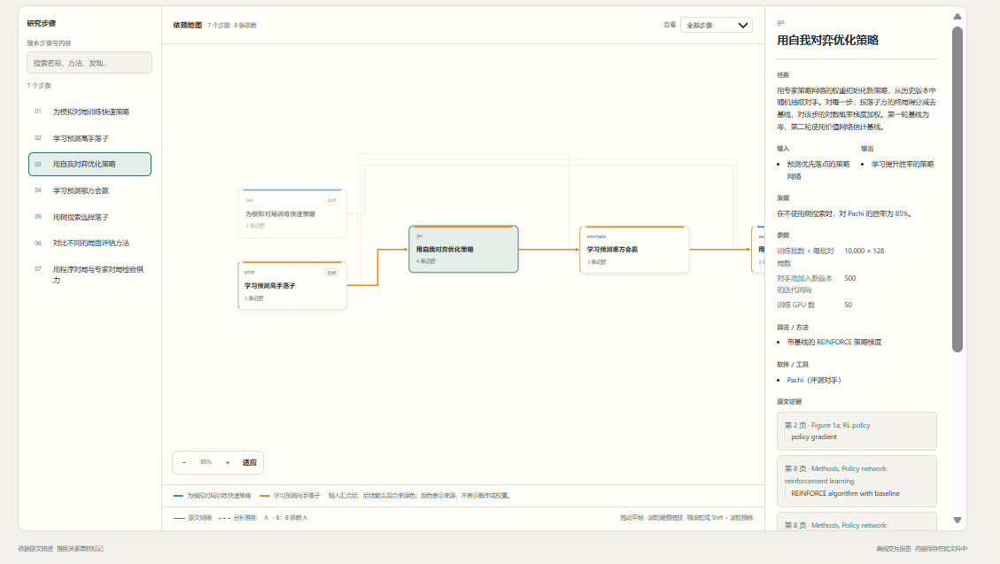
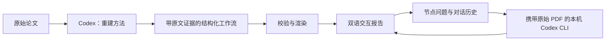

# paper2flow

[English](README.md) · [简体中文](README.zh-CN.md)

面向科研的 Codex 工作流技能：把论文转化为可交互、可追溯原文证据的方法说明。

**paper2flow** 是一个 Codex 技能，可生成带证据链接的交互式方法报告。你可以探索并行分支与输入汇合，查看支持某条依赖关系的原文，并针对节点连续追问原始 PDF。



下载 HTML 文件后，可用浏览器打开交互报告：[AlphaGo](examples/alphago/index.html) · [EHT 的 M87 黑洞成像研究](examples/eht/index.html)。

**许可：** [MIT](LICENSE)，允许使用、修改、再分发和商业集成。

## 功能

- **方法依赖图**：每个节点说明任务、输入、输出、参数、发现和证据；箭头区分原文明确的依赖与分析者推断。
- **英文优先的完整双语报告**：直接根据原论文写英文底稿，再翻译成中文。语言切换同时更新正文、详情、打印内容、导出和提问上下文。
- **基于原 PDF 的提问**：可选的本机桥接复用已安装 Codex CLI 的现有登录，自动绑定原始 PDF。
- **按节点连续追问**：可开始新话题，也可携带当前节点已完成的问答继续提问；不同节点的对话分别保存。
- **顺手的画布**：轻柔的指针中心缩放、横滚轮和 Shift＋滚轮平移、拖动不选中文字，并支持键盘、搜索、聚焦筛选和明暗主题。
- **输入来源配色**：选中节点或切换主题时保持来源色；分支汇合后，后续箭头以渐变保留全部来源色，支持100种不同来源。

用它理解论文、检查原文证据，并规划后续研究。

## 工作流设计



项目结合了四项科研 Agent 工程能力：

- **基于证据的工作流设计**：通过结构化约定表示方法、参数、输入、输出与依赖，并链接到论文原文。
- **Agent 与工具集成**：将有明确操作指引的 Codex 分析流程连接到 PDF 提取、数据校验、报告渲染和本机问答桥接。
- **上下文管理**：每次追问组合所选节点、相关依赖、原始 PDF，以及该节点已完成的对话。
- **交互产品工程**：提供完整中英双语报告、可导航的依赖画布、稳定的来源配色和确定性的交互检查。

## 由 Agent 构建

在 Codex 中打开这个仓库文件夹，发送下面这条提示词。如果希望同时生成第一份报告，附上论文即可。

```text
请把当前仓库中的 paper2flow 安装并部署到我的电脑。

阅读 SKILL.md 及相关参考文件，识别我的操作系统与可用 Python 环境，
将技能安装到合适的 Codex 技能目录，并安装所需依赖。检查技能文件和
辅助命令已就绪，节点提问复用我现有的 Codex CLI 登录与配置。

如果我已附上论文或提供论文路径，请使用安装好的技能讲解这篇论文的
方法。直接根据原论文撰写英文底稿，再翻译成完整中文。校验工作流、
渲染交互报告、绑定原始 PDF，自动配置本机节点提问与追问上下文，
启动本机报告服务，并在浏览器中打开可用页面。生成可重复使用的
启动入口，供我以后重新打开报告。

完成当前可执行的部署，交付技能安装位置、调用方式；生成了报告时，
一并交付其启动入口。
```

## 如果你真的要手动构建

### 环境要求

| 组件 | 用途 |
| --- | --- |
| 支持技能的 Codex | 阅读论文并撰写带证据的方法说明 |
| Python 3.10+ | 本地提取、校验、渲染与报告服务 |
| `pypdf` | PDF 提取与基于 PDF 的提问 |
| 已安装并登录的 Codex CLI | 可选的实时节点提问 |
| Node.js | 可选的 JavaScript 回归检查 |

界面由自包含 HTML、CSS 和 JavaScript 构成，无需前端构建，也不依赖远程脚本；仓库不包含模型 SDK。

### 安装为 Codex 技能

下载或克隆仓库，将其内容放进名为 `paper2flow` 的文件夹：

- macOS/Linux：`~/.agents/skills/paper2flow/`
- Windows：`%USERPROFILE%\.agents\skills\paper2flow\`

`SKILL.md` 应直接位于这个文件夹中。也可以放在项目级 `.agents/skills/paper2flow/` 目录。技能发现和调用方式见[官方技能文档](https://developers.openai.com/codex/skills/)。

在技能或仓库目录中，用自己的 Python 安装 PDF 依赖：

```bash
python -m pip install -r requirements.txt
```

如果你的解释器命令是 `python3`，相应替换 `python`。技能本身不要求填写 OpenAI API Key；实时提问复用 Codex CLI 的现有登录与配置。

然后向 Codex 提出：

```text
用 $paper2flow 解释这篇论文的方法。
重点说明输入、处理步骤和验证方式之间的依赖关系。
直接依据原论文写英文底稿，再提供中文译稿。
生成交互式报告，并配置本机节点提问。
只解释论文，不要实现模型。
```

### 使用自己的论文

#### 1. 提取原文

```bash
python scripts/paper2flow.py extract paper.pdf --out out/paper.txt
```

同时生成的 `out/paper.txt.source.json` 保存来源元数据和原 PDF 绑定。扫描页或无法提取的页面需要 OCR 或目视检查；提取器不会补写缺失内容。

#### 2. 让 Codex 重建方法流程

请 Codex 阅读原始材料，生成：

- `out/workflow.json`：schema 版本为 `1.0` 的英文主稿。
- `out/workflow.zh.json`：该主稿的完整中文译稿。

确定性的辅助脚本负责校验与渲染，不会独立理解论文。具体要求见 [SKILL.md](SKILL.md)、[分析指南](references/analysis-guide.md)和[数据约定](references/data-contract.md)。

翻译必须保留来源身份、节点 ID、依赖关系、原文明确／分析推断标记，以及未翻译的精确原文证据。参数和科学含义必须一致。渲染器会拒绝结构或证据改动；科学含义仍需作者核对。

#### 3. 渲染并启动

```bash
python scripts/paper2flow.py render out/workflow.json --translation zh=out/workflow.zh.json --out out/report.html
python scripts/report_server.py out --launch --open
```

渲染器也会在报告旁生成 `OPEN_REPORT.cmd` 和 `OPEN_REPORT.sh`。Windows 可双击 `.cmd` 文件；macOS/Linux 可运行 `sh out/OPEN_REPORT.sh`。入口按当前安装位置生成；移动技能、报告或 Python 解释器后应重新生成。

服务会启动或复用该报告自己的本机服务，检查就绪状态，再打开实际网址。它会选择可用端口，不会停止其他服务。本机网址只在服务运行时有效，需要时重新使用启动入口。

默认显示英文。若要初始显示中文，提供完整译稿并添加 `--language zh`。没有中文译稿时，界面会明确标为不可用，不会只翻译按钮却保留另一种语言的正文。

## 提问与追问

1. 选择节点，打开 **Ask Codex／追问 Codex** 面板。
2. 输入问题；点击 **Ask Codex／提问** 会为当前节点开始新话题。
3. 输入后续问题，点击 **Follow up／追问**，携带该节点此前已完成的问答。

每次请求包含原 PDF、当前节点、相关依赖，以及当前显示语言的报告上下文。桥接校验原文件指纹，并以只读模式调用 Codex CLI。此前回答只作为对话上下文，不作为论文证据。

历史记录保存在页面内存中，切换节点或语言时仍保留；刷新或关闭页面会清空。请求失败会保留此前成功的问答。历史超限时明确拒绝，不会静默截断。实时提问使用本机 Codex CLI 的账号和模型配置，可能消耗额度或产生费用。

若原 PDF 移动，应在两种语言的工作流中更新已核验的路径，重新生成报告并重启服务，无需重新填写 API Key 或手动连接桥接 Token。

## 隐私与桥接边界

- **不附带任何凭据**：每位使用者在自己的电脑上使用自己的 Codex 登录。安装仓库不会获得他人的账号权限。
- **静态文件与实时页面不同**：服务在内存中生成桥接 Bearer Token，并注入本机实时响应；保存的 HTML 和工作流 JSON 不包含该运行 Token。旧的诊断入口 `agent_bridge.py` 会把桥接 Token 打印到终端，其输出应保密。
- **仅面向可信本机环境**：服务监听 `127.0.0.1`。实时页面为自动连接而包含桥接 Token，因此能读取该页面的其他本机程序也能取得 Token。回环地址和浏览器来源校验不能隔离不可信的本机用户或进程。不要将服务代理、转发或隧道暴露到公网。
- **只读不等于凭据隔离**：桥接继承本机 CLI 的环境和配置，不提供独立的凭据沙箱，也不保证恶意源材料无法影响 agent。
- **实时提问会使用你配置的模型服务**：完整提取的 PDF 文本、问题上下文和追问历史会经 Codex 发出。敏感或受限制的材料应使用合适的配置。离线浏览报告不调用模型。
- **生成文件可能包含私人信息**：报告和启动文件可能包含本机路径或研究内容。不要提交这些文件，也不要把含运行 Token 的实时页面另存后分发。

附带的 `.gitignore` 排除常见生成文件、论文、启动入口、缓存、凭据和运行状态，但不会移除 Git 已跟踪的文件。请检查实际提交内容。

## 检查修改

```bash
python scripts/check_report_defaults.py
```

如果 Node.js 不在 `PATH` 中，可用 `--node` 指定其可执行文件路径；若没有 Node，检查器会明确报告跳过 JavaScript 检查。

检查器会创建临时合成 PDF 和本机 HTTP 服务，使用假回答器并在结束后清理。它检查完整语言切换、导出、追问隔离、画布操作、1—100种来源色、请求校验、启动复用和端口回退，不调用 Codex 或模型，不证明科学有效性，也不能代替浏览器目视检查。

## 目录结构

```text
SKILL.md                  技能入口
agents/openai.yaml        Codex 技能元数据
assets/                   HTML 报告模板
references/               分析、数据、交互及节点提问说明
scripts/                  提取、渲染、本机桥接及回归检查
requirements.txt          PDF 依赖
LICENSE                   MIT License
NOTICE                    版权与署名通知
LICENSE.zh-CN.md           许可中文说明
```

## 署名与科研使用

再分发项目时保留适用的版权与署名通知；项目署名记录在 [NOTICE](NOTICE)。

如果 paper2flow 对你的研究有帮助，欢迎在致谢或引用中提及项目并链接仓库，帮助其他研究者发现这套工作流。

欢迎贡献：说明使用场景、提供示例，并给出检查改动效果的方法。现有检查方式见“检查修改”。

## 许可证

本项目采用 [MIT License](LICENSE)，允许按其条款使用、修改、再分发和开发商业产品。在软件的所有副本或实质性部分中保留版权声明和许可声明。

除文件另有说明外，项目原创代码、技能指引、文档、模板与示例均采用此许可。独立依赖保留各自许可，你的科研内容保留自身权利。

除非明确另行说明，提交的贡献采用 MIT。本项目为独立社区项目。
